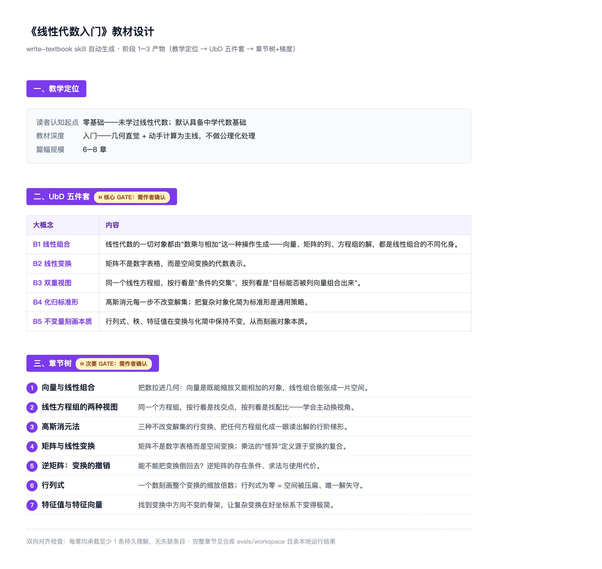
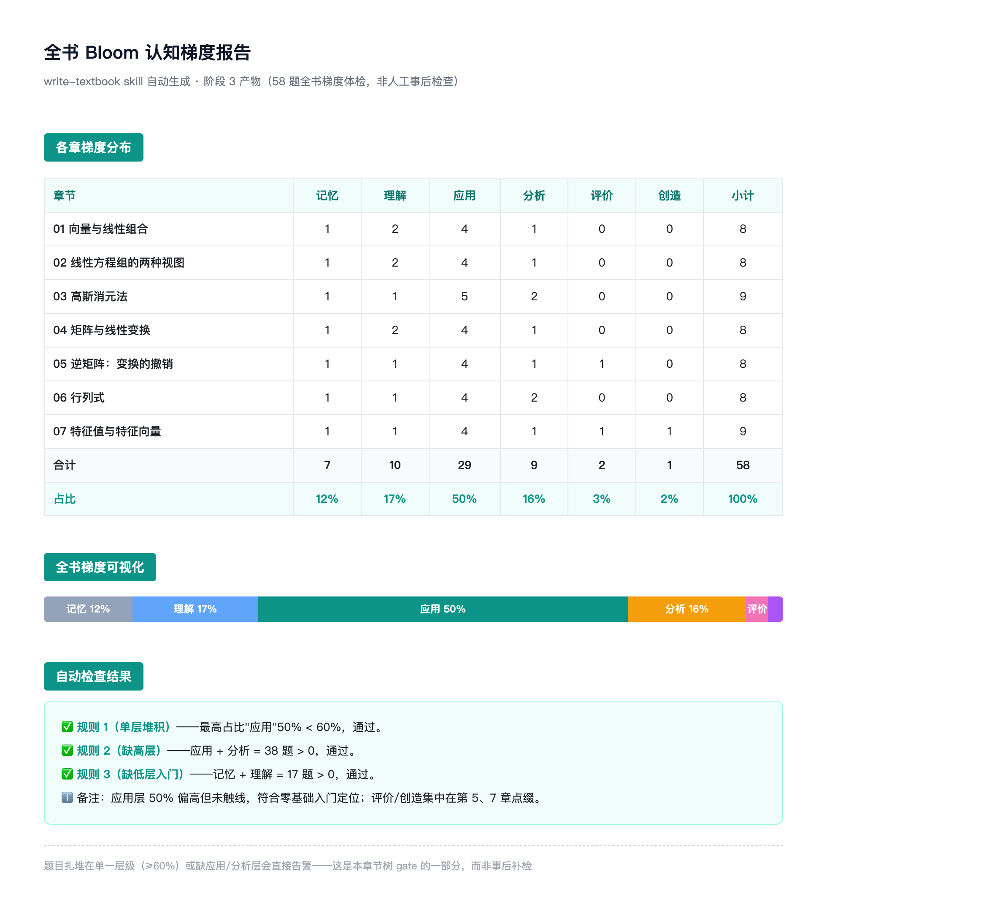
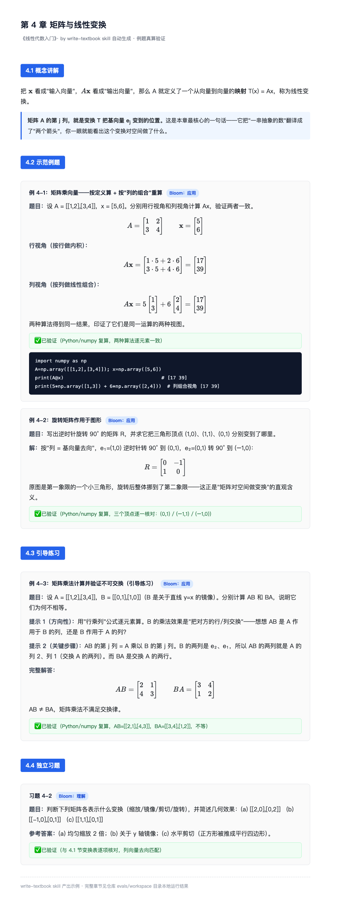
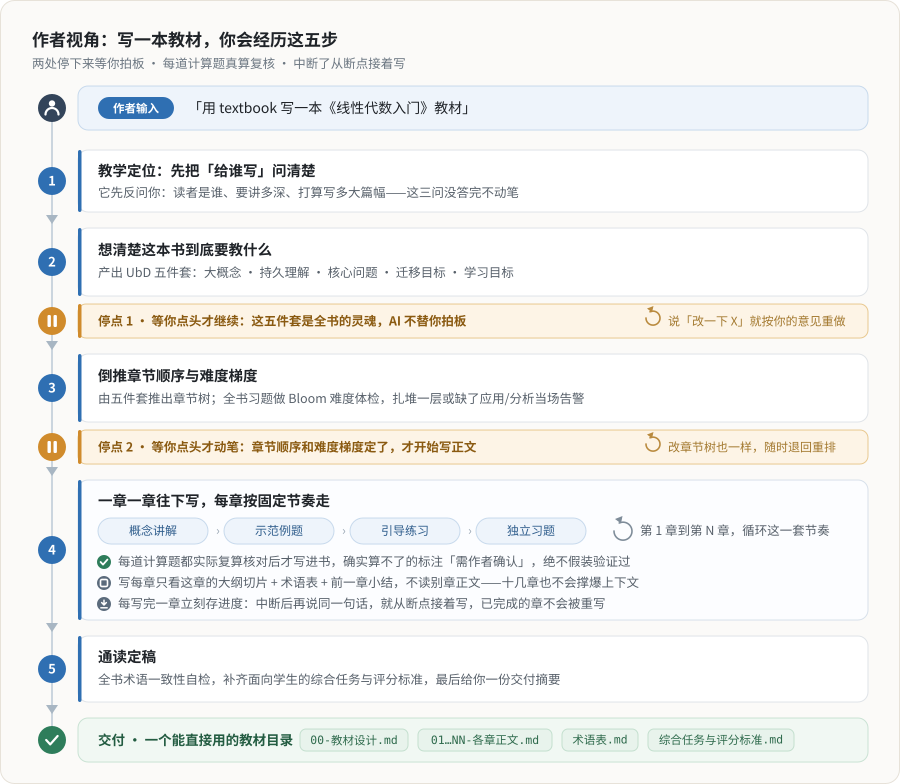

# Textbook-Writer-Skills 教材写作套件

[](https://github.com/cabbage2000-lab/textbook-writer-skills/actions/workflows/ci.yml)
[](LICENSE)
[](CHANGELOG.md)


**简体中文** | [English](README.en.md)

Textbook-Writer-Skills 是一套装进编程智能体（Claude Code / Codex / 国内 WorkBuddy）的教材写作 skill 组合。它把成熟的教学设计方法装进 AI 的工作流：先想清楚「学生学完该带走什么」，再倒推章节和习题，一章一章写出有主线、有梯度、题目答案可信的成体系教材——中途断了随时续写。当前 **v0.4.0**：5 个 skill（1 个主调度 + 3 个流水线子 skill + 1 个独立辅助）覆盖从工作目录规划到审核定稿的五阶段全流程，理科与人文社科都能写。

**一套内核，多个学科门类。** 学科差异不散落在流程里，而是收拢成可插拔的**学科档案**——随学科变化的只有四件事：题型集、验证手段、认知动词、章内段义。内置三份：`stem` 面向数学、物理、计算机等答案可复算的学科（已跑通全案回归）；`humanities` 面向历史、哲学、文学、政治学、社会学、艺术史等答案取决于论证的学科，把"真算复核"换成"核对来源"（大纲与单章两条路径已由 eval 7、8 实跑验证）；`economics` 面向经济学与金融学这类**混合**学科——模型题能复算、统计数据只能核来源、政策题两者都不适用而要给论证要点，三类手段在同一本教材里交织（eval 9、10 待跑）。三份档案共用同一套验证纪律，换的只是核的方式。支持一个新门类不需要改内核，只需加一份档案、在索引里登记一行。

阶段交接契约、落盘布局与状态机的准确定义以 [handoff-contract.md](skills/textbook/references/handoff-contract.md) 为准，学科差异的收口处是 [subject-profile-spec.md](skills/textbook/references/subject-profile-spec.md)。

## 设计理念

**拼的是教学设计，不是长文生成。** 写教材的难点不在写作本身，在教学设计。已有工具解决的是「把素材组织成长文档」，这套 skill 解决的是「怎么把一门知识教明白」。

- **关键决策由作者拍板。** 教学定位、UbD 五件套、章节树是一本教材的灵魂。skill 给出草案后会停在两个检查点（gate）等作者明确确认，任何「流程优化」都不得绕过——它的职责是逼你想清楚，不是替你做主。
- **诚实优先于流畅。** 验证不了的结论宁可标注「需作者确认」，也不输出一个看起来自信的编造结果。
- **用流水线代替一口气写完。** 流水线上的 4 个 skill 各管一段，阶段之间靠书面契约交接，互不读对方的中间过程——这是长教材写得完、每章质量稳定的工程保证。

**不可妥协的底线**：每道题的答案必须按学科档案定义的手段核过才输出（理科真算复核、文科核对来源与引文出处），验证不了的一律标注 `⚠️ 需作者确认`；阶段 2/3 的双 gate 必须作者明确确认才放行。这两条不与任何目标权衡——**学科可以换，纪律不换**：档案能定义"用什么方式验证"，不能定义"是否需要验证"。

## ✅ 能做的 / ⛔ 不做的

| ✅ 这套 skill 会做的 | ⛔ 这套 skill 不做的 |
| --- | --- |
| 一轮提问定教学定位，产出 UbD 五件套 | 替你拍板教学定位与章节取舍（双 gate 停下等你确认） |
| 倒推章节树，做全书 Bloom 梯度体检 | 替你判断学界有争议处该站哪一边（会列出主要分歧请你定） |
| 按四段式逐章写正文，维护术语表一致性 | 把你已有的讲义素材整理成一门课 |
| 生成三类题，答案按学科档案定义的手段核过（理科真算复核 / 文科核对来源与引文出处） | 输出验证不了却假装已验证的答案；凭记忆编造引文、出处或年份 |
| 进度落盘 `.progress.json`，断了从断点续写 | 在线课程平台与 LMS 集成 |
| 动笔前规划并创建工作目录（可选 git） | 自动生成插图 |

「不替你做主」不是缺点，是这套流水线的设计前提：教学定位、UbD 五件套、章节树决定一本教材的成败，AI 出草案，判断权留给懂学科的你。

> 五条红线的完整表述见 [CONTRIBUTING.md](CONTRIBUTING.md) 的「红线约束」一节，契约层的权威定义见 [handoff-contract.md](skills/textbook/references/handoff-contract.md)。

## 它解决三个坑

直接对 AI 说「帮我写一本教材」，通常会踩中三个坑。这套 skill 的全部设计都是冲着它们去的。

### 坑一：写出来的是知识点汇编，不是教材

AI 很乐意一章一章罗列概念，像把百科词条装订成册：没有贯穿全书的主线，习题和「学生该学会什么」对不上，学完不知道该带走什么。

**解法是先设计、后动笔。** 借用教育学的成熟方法「UbD 逆向设计」：动笔前先逼作者回答「学生学完该带走什么」，形成五件套——大概念、持久理解、核心问题、迁移目标、学习目标——作者确认后，才由此倒推章节树和每章的例题/习题计划，和主线对不上的章要砍或改。配套的梯度纪律：每道题标注 Bloom 认知层级（记忆→理解→应用→分析→评价→创造），全书自动做梯度体检——题目扎堆单一层级（≥60%）或缺了应用/分析层会直接告警；每章正文遵循固定的四段式节奏（概念讲解 → 示范例题 → 引导练习 → 独立习题），不会有的章全是概念、有的章全是题。

下图是同一本《线性代数入门》的阶段 1–3 产物——教学定位、UbD 五件套（大概念）、章节树，两处 gate 停点清晰可见：



同一本教材 58 道题的全书梯度体检报告——分布表、可视化条形图、三条自动检查规则：



### 坑二：例题看着头头是道，一算就错

编造是 AI 写教材最致命的毛病——理科是算错，读者照着例题演算发现书是错的；文科是**伪造引文与史实错位**，虚构文献、张冠李戴的名言、错乱的纪年。两者伤的是同一样东西：整本教材的信誉。

**解法是每道题都验一遍，验的方式由学科档案定。** 理科（`stem` 档案）用一条与解答不同的路径实际复算，复算过程随题附上；文科（`humanities` 档案）把引文逐字核对原文并记明版本与位置，事实性断言核对作者提供的材料或学界公认来源，论述题不给标准答案而给论证要点加评价标准。经济学（`economics` 档案）两种手段都要用——模型题走复算，统计数据核对权威来源并标明机构、口径与年份，同一章里两种验证记录并存。三份档案共用同一套纪律：确实验证不了的明确标注 `⚠️ 需作者确认`，绝不假装已验证，也**绝不凭记忆编造引文、出处或统计数值**。

下图是 `textbook` 端到端跑出的《线性代数入门》第 4 章片段——四段式节奏与每道题的真算验证标签清晰可见：



写文科要先算一笔成本：引文能不能核实，取决于手上有没有材料。eval 8 实测，完全不提供史料时 9 道题里有 3 道挂着 `⚠️ 需作者确认（引文未核）`——**无史料输入时，预期约三分之一的题需要你事后核定**。这不是缺陷，是 `humanities` 档案预告的必然结果（它宁可标注，也不逐字引用一句核不实的话）。想把这个比例压下去，在阶段 1 就把史料、原著版本、文献清单交给它——档案会主动向你索要。

### 坑三：章数一多就写崩

把 10+ 章教材塞进一个对话，上下文迟早爆掉：写到第八章忘了第二章的记号，术语前后不一致；中途断线只能从头再来。

**解法是一章一章独立写、进度落盘。** 每章写作只接收四件轻量输入——该章大纲切片、全书 UbD 五件套、术语表、前章小结（外加一个学科档案 id，决定本章段式与验证手段），不读任何其他章的正文，章数再多也不会撑爆上下文。写作进度实时写入 `.progress.json`，任何时刻中断，下次一句话就能从断点续写，已完成的章不会被重写。

## 五阶段流水线 × skill 能力

一张表看全：谁在哪一阶段干什么、产出落到哪个文件、哪两处会停下等你、由哪个 eval 用例守着。

| 阶段 | 执行 skill | 做什么 | 产出 | Gate | 验收用例 |
| --- | --- | --- | --- | --- | --- |
| **0 · 起步**（可选） | `textbook-init` | 一轮提问弄清写一本还是多本、放在哪里、要不要版本管理 | 工作目录骨架（可选 git 与 README 工作说明） | — | [eval 6](evals/evals.json) |
| **1 · 教学定位确认** | `textbook-outline` | 学科 / 读者起点 / 深度 / 篇幅，并按学科定出学科档案 | `00-教材设计.md`「## 一、教学定位」 | 否（一轮提问） | [eval 1](evals/evals.json) |
| **2 · UbD 预期结果设计** | `textbook-outline` | 大概念、持久理解、核心问题、迁移目标、学习目标 | 「## 二、UbD 五件套（已确认）」 | **⏸ 是（核心 gate）** | [eval 1](evals/evals.json) |
| **3 · 评估与章节设计** | `textbook-outline` | 章节树 + 例题计划 + 全书梯度报告 + 表现性任务 | 「## 三、章节树与梯度规划（已确认）」「## 四、表现性任务」 | **⏸ 是（次要 gate）** | [eval 1](evals/evals.json) |
| **4 · 章节正文编写** | `textbook-chapter` → `textbook-exercises` | 四段式正文（段标题由学科档案定），每道题按档案的手段核过 | `NN-<章标题>.md` × N + 术语表增量 | 否 | [eval 2, 3](evals/evals.json)、[8](evals/evals.json) |
| **5 · 审核定稿** | `textbook`（主 skill） | 通读自检、派生学生可读版任务 | 自检报告 + `99-表现性任务.md` + 交付摘要 | 否 | [eval 5](evals/evals.json) |

阶段 1–5 由主 skill `textbook` 调度，`.progress.json` 状态文件只由它读写——中断-续写机制本身由 [eval 4](evals/evals.json) 守着。阶段 0 不入调度链：`textbook-init` 只创建目录骨架就把你交给 `textbook`；不经 init 直接开写也可以，`textbook` 会自建默认目录。

## 快速开始

三个宿主都能用：Claude Code、Codex、WorkBuddy。

### 安装

**复制下面对应你的智能体的那段话，粘贴给它就行**——它会自己装完，你不用敲任何命令。

**装到 Claude Code** 👇

```text
帮我安装 textbook-writer-skills 教材写作 skill 组合：

1. 把 https://github.com/cabbage2000-lab/textbook-writer-skills 克隆到一个临时目录
2. 确保 ~/.claude/skills/ 存在（没有就创建），把仓库 skills/ 下的**全部 5 个子目录**
   复制进去，一个都不能少：textbook、textbook-outline、textbook-chapter、
   textbook-exercises、textbook-init
   - 这 5 个 skill 是一个整体组合，彼此以 ../<skill 名>/references/ 相对路径互引，
     漏装一个就会断链
   - 同名目录直接覆盖，这就是更新
   - 该目录下其他来源的 skill 一个都别动，千万不要清空目录
3. 删掉临时目录
4. 告诉我装到了哪里、5 个 skill 是不是都装齐了
```

**装到 Codex** 👇

```text
帮我安装 textbook-writer-skills 教材写作 skill 组合：

1. 把 https://github.com/cabbage2000-lab/textbook-writer-skills 克隆到一个临时目录
2. 确保 ~/.codex/skills/ 存在（没有就创建），把仓库 skills/ 下的**全部 5 个子目录**
   复制进去，一个都不能少：textbook、textbook-outline、textbook-chapter、
   textbook-exercises、textbook-init
   - 这 5 个 skill 是一个整体组合，彼此以 ../<skill 名>/references/ 相对路径互引，
     漏装一个就会断链
   - 同名目录直接覆盖，这就是更新
   - 该目录下其他来源的 skill 一个都别动，千万不要清空目录
3. 删掉临时目录
4. 告诉我装到了哪里、5 个 skill 是不是都装齐了
```

**装到 WorkBuddy** 👇

```text
帮我安装 textbook-writer-skills 教材写作 skill 组合：

1. 把 https://github.com/cabbage2000-lab/textbook-writer-skills 克隆到一个临时目录
2. 确保 ~/.workbuddy/skills/ 存在（没有就创建），把仓库 skills/ 下的**全部 5 个子目录**
   复制进去，一个都不能少：textbook、textbook-outline、textbook-chapter、
   textbook-exercises、textbook-init
   - 复制的是这 5 个子目录本身，别把整个 skills/ 目录整体套进去——WorkBuddy 会按
     目录层级给技能命名，多套一层技能名就变成 skills:textbook 了
   - 这 5 个 skill 是一个整体组合，彼此以 ../<skill 名>/references/ 相对路径互引，
     漏装一个就会断链
   - 同名目录直接覆盖，这就是更新
   - 该目录下其他来源的 skill 一个都别动，千万不要清空目录
3. 删掉临时目录
4. 告诉我装到了哪里、5 个 skill 是不是都装齐了
```

装完**新开一个会话**才会加载——已开的会话看不到新 skill。WorkBuddy 还可以在「技能」面板里核对是否装齐。

> **只想在单个项目里用？** 把提示词里的用户级路径换成该项目根目录下的项目级目录：Claude Code 用 `.claude/skills/`，Codex 用 `.codex/skills/` 或 `.agents/skills/`，**WorkBuddy 用 `.codebuddy/skills/`**——注意不是 `.workbuddy/`，它的用户级目录叫 `~/.workbuddy/`，项目级目录却沿用底层 CodeBuddy 内核的 `.codebuddy/`，这一处不对称容易写错。
>
> **用的是别的宿主？** 同一段提示词，把目标路径换成该宿主的 skills 目录即可。装错位置的表现是 skill 一个都不出现、且没有任何报错——各宿主的 skills 目录**互不读取**，几个宿主都用就各装一份。
>
> **能不能只装一个？** 不能。哪怕只想用 `textbook-exercises` 单独出题，它也要读 `textbook-outline` 的 Bloom 动词表和 `textbook` 的交接契约——5 个一起装是最低要求。
>
> **一点都不想装？** 用 Codex 或其他读 `AGENTS.md` 的宿主直接打开本仓库目录也能用：仓库根的 [AGENTS.md](AGENTS.md) 会把「写教材」一类请求路由到对应 skill，无需任何安装。

#### 更喜欢自己敲命令？三个宿主都支持插件式一键安装

本仓库自身就是插件市场，插件形态多一个好处：能用一条命令更新。

Claude Code——在会话里依次执行：

```text
/plugin marketplace add cabbage2000-lab/textbook-writer-skills   # 也可用本地仓库路径
/plugin install textbook-writer@textbook-writer-skills
```

WorkBuddy——同样在会话里执行（它读自己的 `.codebuddy-plugin/` 清单）：

```text
/plugin marketplace add cabbage2000-lab/textbook-writer-skills
/plugin install textbook-writer@textbook-writer-skills
```

Codex——在终端里执行：

```bash
codex plugin marketplace add cabbage2000-lab/textbook-writer-skills
codex plugin add textbook-writer@textbook-writer-skills
```

两条路装的是同一套 skill，**别对同一个宿主两种都用**——会装出两份。WorkBuddy 的插件清单格式已由作者在其他项目实测可用，本仓库按同一格式编写。

想在本仓库内开发或改着试跑，clone 后执行一次，把 `skills/` 软链为项目级 skills 目录（`.claude/` 已 gitignore，不入库）：

```bash
mkdir -p .claude && ln -s ../skills .claude/skills
```

### 第一次运行会发生什么

新开一个会话，输入：

```text
用 textbook 写一本《线性代数入门》教材
```

1. skill 建立教材项目目录和进度文件 `.progress.json`；
2. 一轮提问确认教学定位：写给谁、多深、多大篇幅；
3. 产出 UbD 五件套，停在 `⏸ 等待确认`——第一个 gate，可确认，也可提修改意见；
4. 确认后产出章节树和全书 Bloom 梯度报告——第二个 gate；
5. 之后逐章写作，每章独立落盘为一个 `.md` 文件，最后通读审核定稿，并产出一份面向学生的综合任务与评分标准。

中途任何时候中断，重新输入同一句话即可从断点续写。

## 怎么开口说：不用背 skill 名

用你自己的话说出你要做什么，宿主会匹配到对应的 skill；显式写出 skill 名（如 `用 textbook-exercises 出几道题`）也完全等价。这套工具适合「自己懂学科、想把知识写成体系化教材」的人：写技术讲义的开发者、把课堂笔记整理成教材的文理科教师和学生、做教学内容的创作者。skill 负责结构和纪律，学科知识的判断仍然在你。

| 你会这么说 | 落到 | 你会拿到 |
| --- | --- | --- |
| 「写一本《线性代数入门》教材」 | `textbook` | 一个教材目录：`00-教材设计.md` + 逐章 `NN-<章标题>.md` + `术语表.md` + `99-表现性任务.md` + `.progress.json` |
| 「设计一份数据结构教材大纲」 | `textbook-outline` | `00-教材设计.md`：教学定位 + UbD 五件套 + 章节树与例题计划 + 全书 Bloom 梯度报告 |
| 「按大纲写第三章」（也可写一篇带完整例题的深度技术文章） | `textbook-chapter` | 一个 `NN-<章标题>.md`：章引言 → 概念讲解 → 示范例题 → 引导练习 → 独立习题 → 本章小结 |
| 「出几道矩阵乘法的练习题」 | `textbook-exercises` | 三类题（示范例题 / 引导练习 / 独立习题）+ Bloom 层级标注 + 每题的验证记录（可复算的题附逐题可运行的复算代码，须核来源的题附出处与核验记录；经济学这类混合学科一章之内两种都会出现） |
| 「初始化教材工作目录」 | `textbook-init` | 目录骨架（可选 git 版本管理与 README 工作说明），随即把你交给 `textbook` 开写 |

**换个学科，说法不用变。**「写一本《中国近代史纲要》教材」和「写一本《线性代数入门》教材」走的是同一条流水线、同一个 skill。差别只在阶段 1：它按学科判定一次学科档案并打印出来（`学科档案：humanities`），此后逐章原样透传——章内段义、题型集、认知动词、验证手段随之切换，中途不重判（换档案等于换验证纪律与段式，已写的章会和后写的章不像一本书）。你不需要指定档案；判得不对，在阶段 1 直接说。学科横跨两边也不必二选一——经济学走的 `economics` 档案本就把复算与核对来源两套手段并置在同一本书里。

### 这些请求会被挡下——但每条都有出口

| 你可能会这么问 | 为什么不做 | 它会把你引到哪 |
| --- | --- | --- |
| 「答案你直接给就行，别真算了」 | 编造答案是 AI 写教材最致命的毛病 | → 照常按学科档案的手段核（理科真算、文科核对来源）；确实验证不了的标 `⚠️ 需作者确认`，绝不假装已验证 |
| 「UbD 那步跳过，直接写章节」 | 双 gate 是红线，绕过就退回知识点汇编 | → 可以很快确认，但不能不确认；对草案有意见直接提修改，修改优先于确认 |
| 「写第八章时参考一下第二章正文」 | 读其他章正文会撑爆长教材的上下文 | → 跨章一致性靠术语表、前章小结、UbD 五件套三个轻量载体传递 |
| 「出几道文科论述题 / 案例分析题」 | `humanities` 档案为论述题定义了验证方式：不给标准答案，但引文与史实照样核 | → 出论述题并附论证要点与评价标准表、标注「开放题」；引文带出处，核不到的标 `⚠️ 需作者确认（引文未核）` |
| 「把我这堆讲义整理成一门课」 | v1 是从零做逆向设计，不是素材重组 | → v1 明确不覆盖；同样不覆盖的还有 LMS 集成与自动生成插图 |

### 串起来看：一本教材从头到尾

```text
 0. 「帮我建个写教材的目录」                  → textbook-init  （可选；不建也行，textbook 会自建默认目录）
 1. 「用 textbook 写一本《线性代数入门》教材」  → textbook 建立项目目录 + .progress.json
 2. 一轮提问：写给谁、多深、多大篇幅            → 阶段 1 教学定位
 3. ⏸ UbD 五件套等你确认                     → 阶段 2 核心 gate（可确认，也可提修改意见）
 4. ⏸ 章节树 + 全书 Bloom 梯度报告等你确认     → 阶段 3 次要 gate
 5. 逐章写作，每章独立落盘、每题按档案手段核过  → 阶段 4
    └ 每章只读四件输入：本章大纲切片、UbD 五件套、术语表、前章小结（外加学科档案 id，定段式与验证手段）
 6. 通读自检 + 学生版表现性任务 + 交付摘要      → 阶段 5
 ── 任何一步中断，重新说同一句话即可从断点续写，已完成的章不会被重写 ──
```

## 为什么可信

这套 skill 的承诺不靠自述，靠五条写进契约、由校验与 evals 守着的红线：

- **每道题都验过。** 答案必须按学科档案定义的手段实际核对后才输出（理科走独立路径复算、文科核对引文原文与来源），验证过程随题附上；验证不了的一律标 `⚠️ 需作者确认`，绝不假装已验证。
- **关键决策你拍板。** 阶段 2/3 的双 gate 必须作者明确确认才放行，任何「优化」不得绕过；「确认，但把 X 改一下」按修改分支处理——修改优先于确认。
- **长教材写得完。** 单章写作只接收输入契约，不读其他章正文；`.progress.json` 只由主 skill 读写，每完成一阶段 / 一章立即写盘。
- **交付无占位符。** TBD / TODO / 待补充 一类占位词不准出现在交付的 `.md` 里，校验脚本强制。
- **跨宿主不锁死。** 核心路径只依赖通用 agent skills 标准（SKILL.md frontmatter + `references/` 分层加载 + 相对路径互引），宿主专有能力只作可选增强，且都写明了纯文本降级路径。

守住它们的是三层防线，前两层由 CI 自动执行（[.github/workflows/ci.yml](.github/workflows/ci.yml)）：

```bash
python3 scripts/validate_skills.py       # ① 结构校验：skills 内容 + plugin 清单一致性 + 仓库健康
python3 -m unittest discover -s tests    # ② 单元测试：校验逻辑本身
# ③ 行为测试：evals/evals.json 的 8 个用例真实运行，改动 skill 后按 CONTRIBUTING.md 映射表重跑
```

第三层无法自动化——用例必须在新开的会话里真实运行（Claude Code 是基线宿主，跨宿主复跑口径见 [evals/README.md](evals/README.md)），对照 assertions 逐条客观判定。这是刻意的：skill 是「给模型看的程序」，改一行指令就可能改变运行行为，而结构校验只能保证文件形态正确。

## 工作原理

两张图，两个视角。先从作者视角看一遍：你说一句话，它替你走完五步，其中两处会停下来等你点头，写完的章即时存盘、断了能续——



换到 skill 视角，分工、调用与三条硬约束是这样的——1 个主 skill 调度 3 个子 skill，另有 1 个独立辅助 skill 负责动笔前的工作目录规划：


图中作为地基的 [handoff-contract.md](skills/textbook/references/handoff-contract.md)，是阶段间交接契约、教材项目落盘布局、`.progress.json` 状态机与重入规则的**全项目唯一权威定义**——5 个 skill 一律引用它，契约字段名上下游逐字一致。这也是 5 个 skill 必须整体安装的原因：它们以相对路径互相引用，漏装一个就断链。

## 里程碑与验收状态

| 里程碑 | 内容 | 对应 eval 用例 | 状态 |
| --- | --- | --- | --- |
| M1 | 骨架搭建：4 skill + 6 references + 校验 | — | ✅ 完成（含 3 项行为冒烟测试） |
| M2 | 大纲 skill 用真实学科跑通双 gate | [eval 1](evals/evals.json) | ✅ 通过（6/6 断言，2026-08-03，含表现性任务评价标准） |
| M3 | 单章 + 例题 skill 跑通 | [eval 2, 3](evals/evals.json) | ✅ 通过（7/7 与 5/5 断言，2026-08-03） |
| M4 | 主 skill 中断-续写机制验证（状态机正确定位续点） | [eval 4](evals/evals.json) | ✅ 通过（3/3 断言，2026-08-03，续写前后章文件 SHA-1 逐字节一致） |
| M5 | 第二学科端到端写完整本教材（含阶段 5 自检与交付摘要），验证不过拟合 | [eval 5](evals/evals.json) | ✅ 通过（8/8 断言，2026-08-03；首跑发现「26/80 题缺验证状态行」缺陷，修复后重跑 11 章 85 题零漏标） |
| M6 | 工作目录初始化 skill（textbook-init）：规划并创建单本/多教材工作目录 | [eval 6](evals/evals.json) | ✅ 通过（6/6 断言，2026-08-03，须在本仓库外运行） |
| M7 | 学科档案层：同一套内核 + 可插拔档案，跑通非 STEM 学科 | [eval 7, 8](evals/evals.json) | ✅ 通过（eval 7 6/6 + eval 8 7/7，2026-08-04）：大纲侧档案路由正确、题型与动词无 STEM 残留、梯度矩阵算术自洽；单章侧无史料时三处引文全部走降级路径、不逐字引用，引文台账落地。另首次覆盖 gate 修改分支 |
| M8 | 混合可验证学科档案（`economics`）：复算与核对来源两类手段在同一本教材内并存 | [eval 9, 10](evals/evals.json) | ⏳ 待跑（档案与用例定义已入库，前两道防线通过；档案层验证的是内核零改动就能容纳第三种验证形态） |

逐条判定证据（断言、产物、判定记录）保存在 `evals/workspace/`（已 gitignore，不入库）；判定纪律、各用例耗时与跨宿主复跑口径见 [evals/README.md](evals/README.md)。

M2–M6 的通过记录对应**加断言前**的用例定义：学科档案层给 eval 1、2 各补了一条断言，且改动触及全部 5 个 skill，按 [CONTRIBUTING](CONTRIBUTING.md) 映射表 eval 1–4 需重跑。**eval 2 已跑**（2026-08-04，三轮）：新增的档案声明断言通过，重构引入的一处漂移已修复并验证，但末轮撞上一处公式规范偶发违规（`\text{}` 内写中文），整体待下一轮复验；eval 1、3、4 仍待跑。`economics` 档案（M8）新增的 eval 9、10 同样待跑——该档案是**纯增量**：新增一个文件、在索引登记一行、把另两份档案第 1 节里"经济学怎么分流"那句改成指向它，内核与既有两份档案的题型集、段式、验证纪律一字未动，因此不影响 eval 1–8 的既有结论。

## 仓库结构

五区：`skills/`（5 个 skill 主体，各自 `references/` 存放知识底座——UbD 指南、Bloom 动词表、章节模板、文体规范、例题验证规范、表现性任务评价标准、工作目录布局，以及学科档案规格与 `profiles/` 下的可插拔档案：随学科变化的题型集、验证手段、认知动词、章内段义都收在那里，支持新学科门类 = 加一份档案）；三个分发清单目录 `.claude-plugin/`、`.codex-plugin/`、`.codebuddy-plugin/`（Codex 的 marketplace 清单另在 `.agents/plugins/`，让仓库自身成为三宿主都能一键装的插件市场）；[AGENTS.md](AGENTS.md)（不自动加载 skill frontmatter 的宿主在仓库内的入口指路文件，免安装可用）；[evals/](evals/README.md)（行为测试用例：prompt + 客观断言，用例定义入库、运行产物不入库）；`scripts/` + `tests/`（结构校验脚本及其单元测试，零第三方依赖，Python 3.10+ 标准库）。

## 贡献

想参与开发或二次定制，先读 [CONTRIBUTING.md](CONTRIBUTING.md)：改动的影响半径（`handoff-contract.md` 牵动全部 5 个 skill）、修改 skill 的完成标准（结构校验 → 单元测试 → 按映射表重跑受影响的 evals 用例 → 更新 CHANGELOG）、写 skill 的规范、新增 skill 清单与发版流程。架构决策摘要见 [docs/adr/](docs/adr/README.md)，版本记录见 [CHANGELOG.md](CHANGELOG.md)。在本仓库内开发的软链装法见上面「快速开始」末尾。

## 许可

[MIT](LICENSE)——可自由使用、修改与分发（含商业使用），保留版权与许可声明即可。
